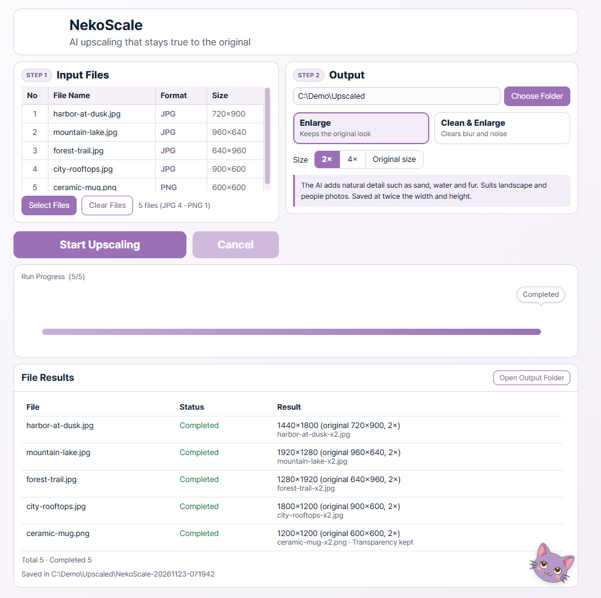
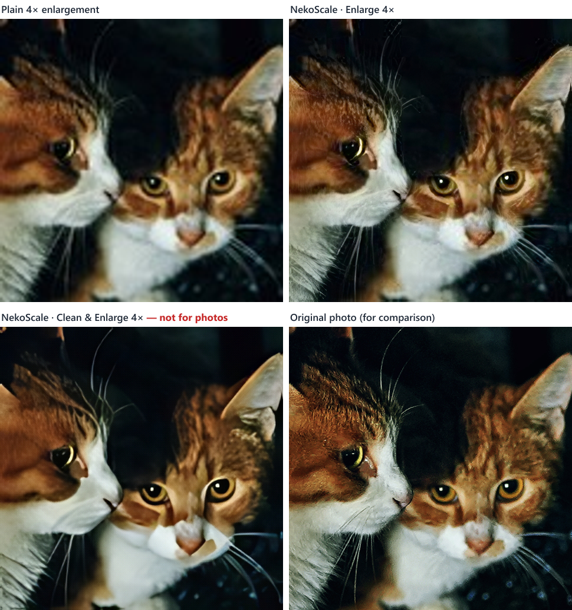
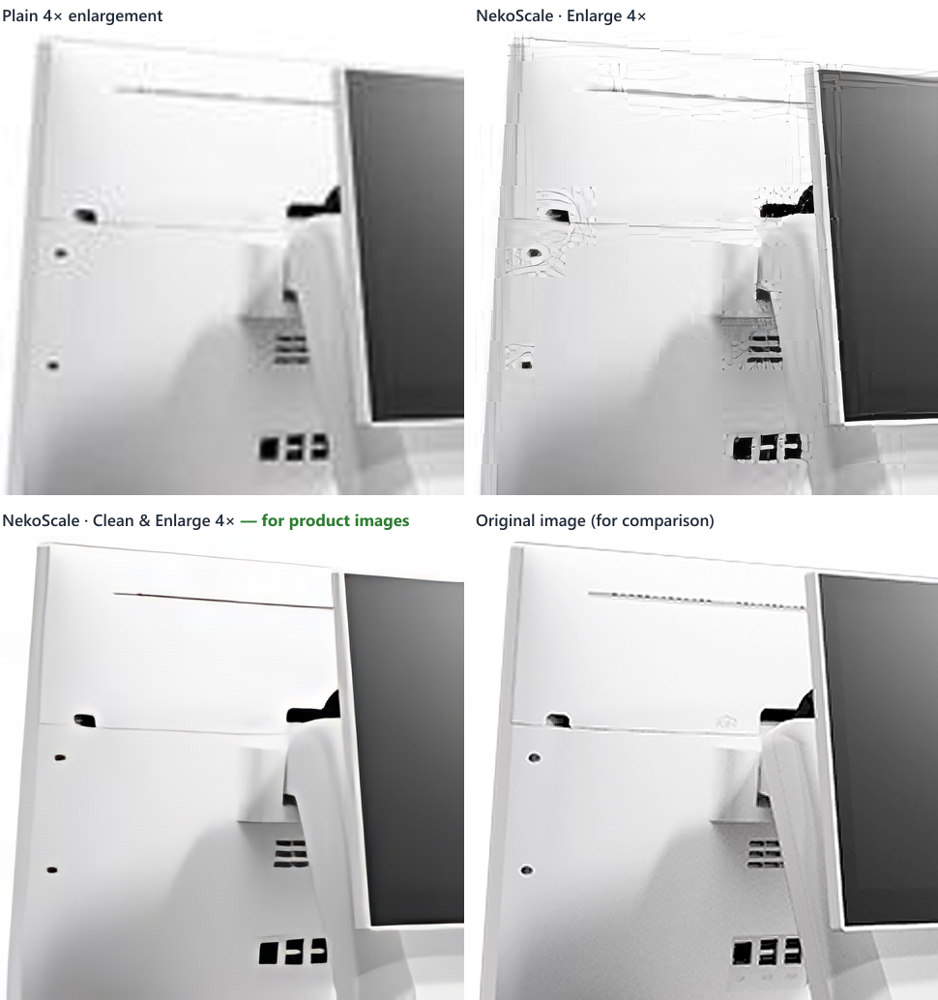
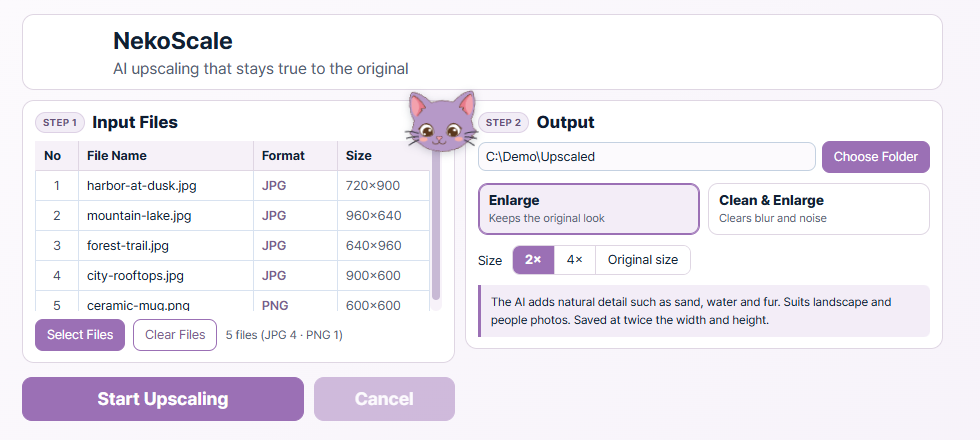
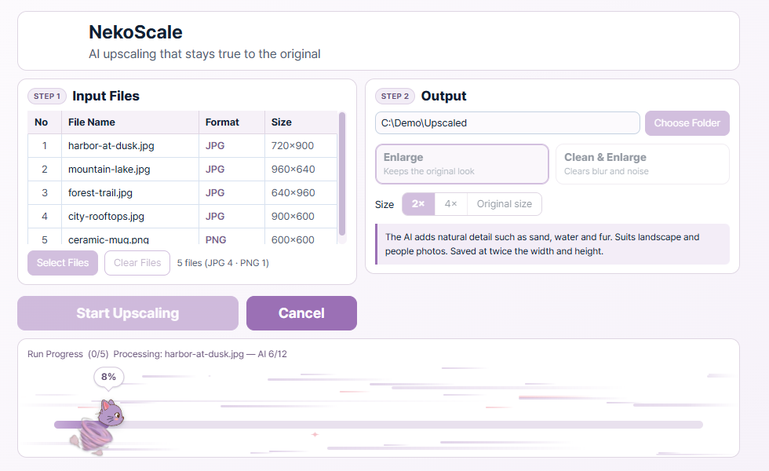
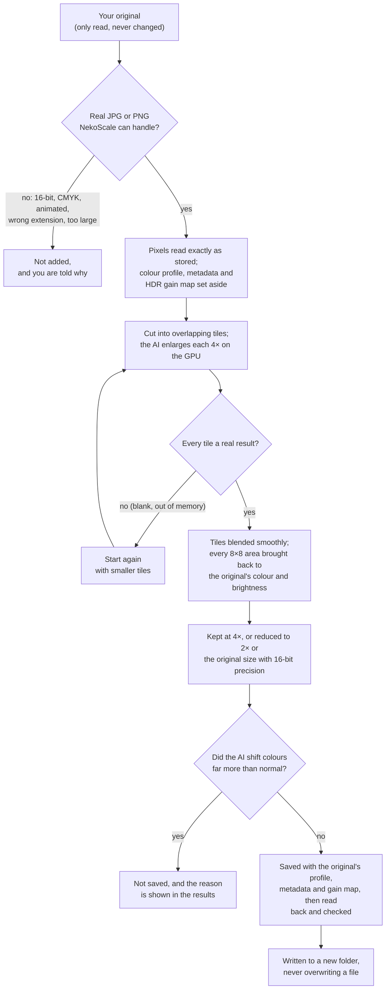

<p align="center"></p>
<h1 align="center">NekoScale</h1>
<p align="center">Upscale JPG and PNG images on Windows with AI, true to the original.</p>



## What it does

- **2×** or **4×** the width and height, or **Original size**: the AI cleans the image at 4× and NekoScale scales it back to the size it had.
- Two purposes, chosen by you:
  - **Enlarge** keeps the original look and adds natural detail such as sand, water and fur. For landscape and people photos.
  - **Clean & Enlarge** clears blur, noise and compression marks. For small or compressed product images.
- Add many files at once (JPG and PNG can be mixed) and upscale them in one go.



*Part of a photo was reduced to 120×120 pixels and saved as a JPG, then enlarged 4× to 480×480 again. Each panel is shown at its real size, with nothing edited, next to the original photo. **Enlarge** keeps the fur looking natural.* **Clean & Enlarge is not recommended for photos:** it smooths fine texture such as fur until it looks painted.



*Part of a product image was reduced to 120×120 pixels and saved as a strongly compressed JPG (quality 75), then enlarged 4×. **Enlarge** turns the compression marks into false detail; **Clean & Enlarge** clears them and gives clean surfaces and edges.* **For small or compressed product images, choose Clean & Enlarge.**

## What to expect

- **Photos in good condition (Enlarge):** the enlarged photo keeps its colours and brightness, and the AI draws fine detail that the original only hints at. Like every AI upscaler, it makes that detail up: it looks natural, but it is not a recovered "real" detail.
- **Small or compressed product images (Clean & Enlarge):** blur, noise and blocky compression marks are cleaned up. Very small text cannot be read back by any upscaler: at 2× or 4× it may turn into different strokes. If text matters, choose **Original size**, which cleans the image without changing its size.
- **It takes a while.** The AI is heavy work for the graphics card. On our test PC a 1080×1350 photo takes about 10 seconds with Enlarge, a 60-megapixel camera photo about 7 minutes (see [How long does it take?](#how-long-does-it-take)).

## Download

1. Download `NekoScale-x.y.z-portable.exe` from [Releases](../../releases/latest). This repository is the only official source.
2. Optional: check the file in PowerShell and compare the result with the SHA-256 in the release notes.
   ```powershell
   Get-FileHash .\NekoScale-x.y.z-portable.exe
   ```
3. Run the EXE. There is nothing to install.

## First run

- NekoScale is not code-signed, so Windows may show "Windows protected your PC". If you downloaded it from this repository and the SHA-256 matches, choose **More info → Run anyway**.
- On PCs where Smart App Control is on, Windows may block NekoScale.
- Each start unpacks the app to a temporary folder (about 410 MB including the AI models; about 4 seconds on our test PC, a little longer the first time while Windows checks the new file). It is removed when NekoScale closes.

## How to use

1. Drop JPG or PNG files onto the window, or click **Select Files**. Files NekoScale cannot handle are not added, and you are told why.
2. Choose an output folder, the purpose (**Enlarge** or **Clean & Enlarge**) and the size (**2×**, **4×** or **Original size**). One list uses one purpose and one size.
3. Click **Start Upscaling**. The cat runs along the bar while the AI works; you can keep using your PC.
4. The results are saved in a new folder (`NekoScale-<date>-<time>`) inside the output folder, named like `photo-x2.jpg`. The results table shows each new size and what was kept, and **Open Output Folder** takes you there. Your originals are not touched.




## Why NekoScale

- **True to the original.** After the AI, NekoScale brings each small area of the picture back to the original's colour and brightness, so the result does not drift in tone. Transparency is kept exactly as in the original at the original size.
- **Keeps what is in your files.** Colour profiles (ICC), EXIF and XMP metadata, orientation, transparency, and HDR gain maps in photos (Adobe and ISO 21496-1) are carried over to the result.
- **Offline and private.** Everything happens on your PC. NekoScale does not connect to the internet and collects nothing: no account, no analytics, no update checks.
- **Safe with your files.** Your originals are never changed or overwritten. Each run saves into a new folder, and every result is checked before it is saved.
- **Uses your graphics card and CPU together.** The AI runs on the GPU through Vulkan while the CPU finishes the previous images. On PCs with 8 or more CPU threads several images are finished at once, so lists of small images go much faster.
- **Built with security in mind.** Electron checks the code in the app archive as it loads it, the AI engine files are checked against known SHA-256 hashes when the app starts, only the JPG and PNG decoders it needs are enabled, and the window runs in a sandbox.
- **Portable.** One EXE. No installation and no administrator rights.

## Under the hood

Every image goes through the same steps, and each step is checked rather than trusted:



### Every file is checked first

- Files are recognised by their content, not their extension. NekoScale reads the JPEG and PNG structures itself before any decoder sees the file, and refuses what it does not support (16-bit PNG, CMYK JPG, animated PNG, files whose extension does not match their format, Ultra HDR photos in Google's format) instead of converting them.
- Size limits are checked from the file header, and the decoded image must match it.

### True to the original

- The AI works on overlapping tiles that are blended with smooth weights, so there are no seams.
- AI models shift colours a little. NekoScale compares the average colour of every 8×8 area of the result with the same area of the original and corrects the difference smoothly (the method of chaiNNer's "Average Color Fix").
- Reducing to 2× or to the original size is done with 16 bits per channel and rounded once at the end, which avoids the slight brightening an 8-bit reduction causes.
- Transparency goes through the same AI as a grey image (as Real-ESRGAN does it). At the original size the original transparency is kept exactly.
- If the AI moves colours far more than it ever did on the reference images, the file is not saved and you are told why. Blank tiles from a failing graphics driver are caught too, and the work is repeated with smaller tiles.

### What is kept

- The colour profile, EXIF, XMP and Photoshop data are copied into the result as they are, at file level, instead of being rewritten by an image library. Only the image size in EXIF is updated.
- Pixels are processed as stored, in the original's colour space, so wide-gamut photos (Display P3, Adobe RGB) keep their colours.
- HDR gain maps are enlarged by the same factor as the photo, so the HDR version keeps its detail.

### Your files stay safe

- Originals are only read. Each result is written under a temporary name and gets its final name only after it has been checked: it opens, has the right size, and keeps its profile, metadata, transparency and gain map. An existing file is never overwritten.
- Cancelling stops within a fraction of a second. In tests that cancelled well over a hundred times at random moments, every file left under its final name was complete, and no partial or temporary files were left behind.

### Speed without changing the result

- Tiles of several images go to the AI together, largest first, so the graphics card stays busy and its memory stays within a known limit. Its memory decides the tile size.
- While the graphics card works on the next tiles, the CPU blends, corrects and reduces the previous ones. On PCs with 8 or more logical processors several CPU threads do this at once (a quarter of them, up to 4); on smaller PCs one thread does it, which measured faster there. How the work is split does not change the result: tests compare the outputs byte for byte.

### Security and privacy

- The AI engine and its models are checked against SHA-256 hashes stored inside the app's integrity-checked code every time it starts.
- Only the JPEG and PNG decoders are enabled in the process that reads your images.
- Electron refuses to run the code in the app archive (app.asar) if it was modified, Node.js debugging features are switched off in the build, and command-line options that would weaken the sandbox are removed or refused.
- The window runs in a sandbox and cannot navigate, open other windows or ask for permissions. Electron's automatic spell-check dictionary download and proxy detection are turned off, so NekoScale makes no network requests.

NekoScale is built on Electron and sharp (libvips). The AI runs in Real-ESRGAN-ncnn-vulkan, built for NekoScale from its original source with a current ncnn, with the models 4xLSDIR and 4x-NMKD-Superscale (Enlarge) and Real-ESRGAN's realesr-general-x4v3 (Clean & Enlarge).

## Requirements

|  | Minimum | Recommended |
|---|---|---|
| Windows | 10 (64-bit) | 11 (64-bit) |
| CPU | 4 cores / 4 threads | 8 threads or more |
| Graphics card | Vulkan driver, 4 GB of video memory | 8 GB of video memory or more |
| Memory | 8 GB | 16 GB or more |
| Free disk space | 4 GB | 8 GB on an SSD |
| Screen | 1280×720 | 1920×1080 |

- NekoScale is tuned and tested on an AMD Radeon RX 9070 XT. **NVIDIA and Intel graphics cards are not guaranteed**: they should work through Vulkan, but they have not been tested.
- NekoScale has been run on Windows 11 with 16 GB of video memory and 32 GB of memory. The minimums are calculated from measurements on that PC; Windows 10, other graphics cards and smaller PCs have not been tested.
- With less video memory, NekoScale works on smaller pieces of the image, which is slower. Clean & Enlarge needs much less video memory than Enlarge (about 1 GB is enough). More than about 8 GB of video memory is not used.
- Memory: the largest image NekoScale accepts used about 5 GB, and a 60-megapixel camera photo at 2× about 6 GB of NekoScale's own memory at most. Lists of small images used about 2 GB on our 24-thread PC, because several images are finished at once (about 1.3 GB with 8 threads, under 1 GB with 4).
- Disk space: while it works, NekoScale keeps up to about 3.5 GB of temporary files for Enlarge (about 2 GB for Clean & Enlarge). It checks the free space before it starts. The results need space of their own in the output folder.

**How many CPU threads does it actually use?** Threads busy while upscaling our test lists (a thread counts when it was busy at least half of each quarter second). The 4- and 8-thread figures were measured by limiting a 24-thread CPU to that many threads.

| CPU threads | Enlarge, 20 photos at 2×: typical / peak | Clean & Enlarge, 28 product images at 2×: typical / peak |
|---|---|---|
| 4 | 0 / 4 | 3 / 4 |
| 8 | 0 / 8 | 4 / 8 |
| 24 | 0 / 18 | 5 / 21 |

"Typical" is the median: at least that many threads were busy for half of the time or more. With Enlarge the graphics card does almost all the work (it was busy about 97% of the time) and the CPU mostly waits. Clean & Enlarge uses a lighter AI, so finishing the images is a bigger share: on PCs with 8 or more threads NekoScale finishes several images at once, using a quarter of your threads (at most 4) plus the image library's threads.

### How long does it take?

Measured on one PC (AMD Radeon RX 9070 XT, Ryzen 9 3900X):

| Images | Size | Time |
|---|---|---|
| Photo, 1080×1350 | Enlarge 2× or 4× | about 10 s each |
| Product image, about 800 px wide, in a list | Clean & Enlarge 2× / 4× / Original size | about 0.7 / 0.8 / 0.6 s each (limited to 4 threads: about 1.0 / 1.4 / 0.7 s) |
| Camera photo, 9504×6336 | Enlarge 2× or Original size | about 7 minutes |
| The largest accepted image (a 268-megapixel result) | Enlarge, Original size | about 37 minutes |

## Good to know

- One list holds up to 1,000 files, all upscaled with the same purpose and size.
- Size limits: the result can be up to about 268 million pixels; 4× needs an image of up to about 16.7 million pixels. Files that are too large for the chosen size are skipped with a note.
- Not supported (refused with the reason): 16-bit PNG, CMYK JPG, animated PNG, files whose extension does not match their format, and Ultra HDR photos in Google's format.
- With Clean & Enlarge at 2× or 4×, small text can change shape. If text matters, choose Original size.
- Settings are stored in `%APPDATA%\NekoScale` (output folder and last choices, no file names). Delete that folder to remove them.
- The **Feedback on GitHub** button in the app opens this repository's Issues page in your web browser. NekoScale itself sends nothing.

## License

NekoScale is free to use and is provided as is, without warranty. See [TERMS.md](TERMS.md).
NekoScale includes third-party software and AI models under their own licenses: see `THIRD-PARTY-NOTICES.txt` in each release, or in the app click the cat at the top, then **View Licenses & Notices**. The source code of the components under the LGPL and the MPL is attached to each release as `NekoScale-x.y.z-third-party-sources.zip`.

## Feedback

Found a problem or have a suggestion? Open an issue on the [Issues](../../issues) page. In the app, click the cat at the top, then **Feedback on GitHub**.

## Security

Please report security problems privately. See [SECURITY.md](SECURITY.md).
